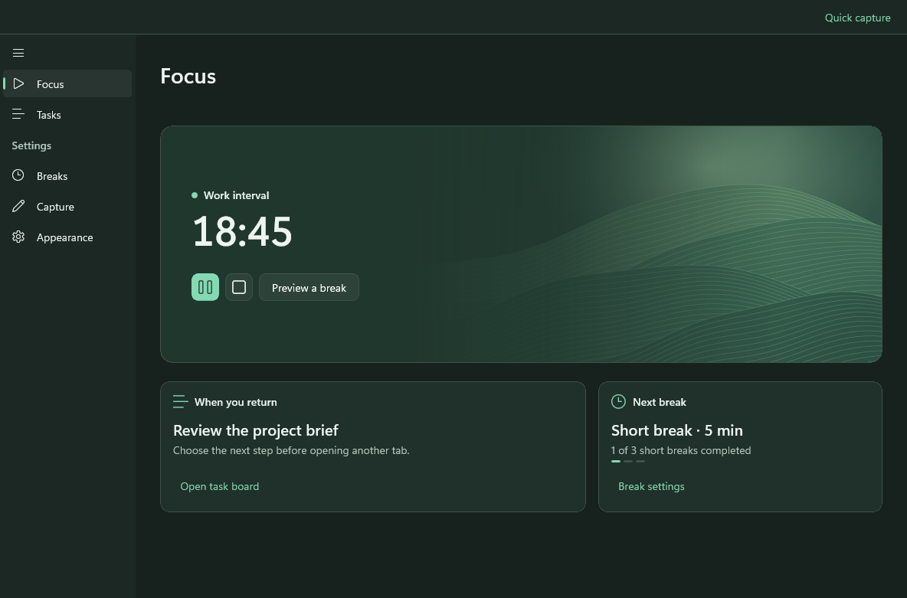
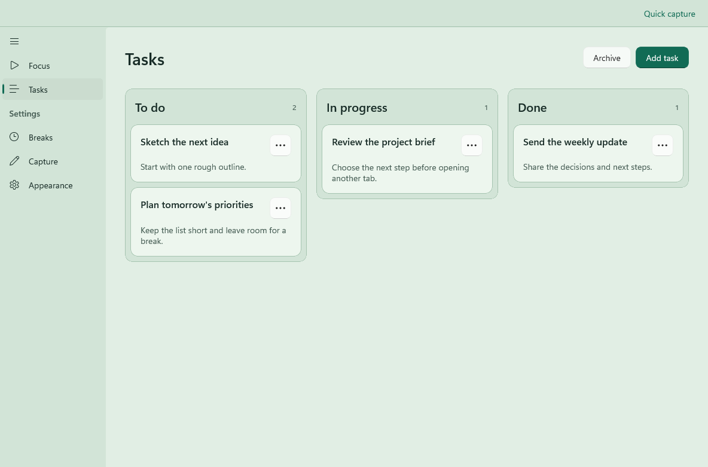
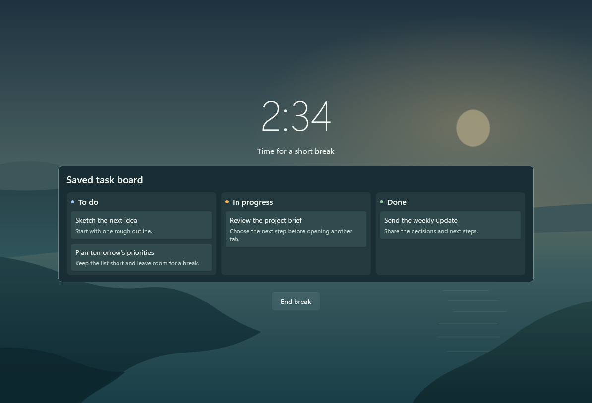
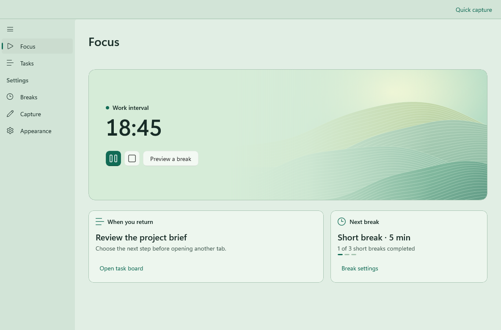

  

<h1 align="center">OpenBreak</h1>

<strong>Take a break. Find your way back.</strong>

A native Windows 11 app that brings your task board back into view during a break.

Windows 11 x64 · First preview pending

  <a href="https://github.com/Colnnn/OpenBreak/releases">Preview downloads</a> ·
  <a href="#quick-start">Quick start</a> ·
  <a href="docs/building.md">Build from source</a>

It’s easy to spend a work session following a side thread and forget what you meant to finish. OpenBreak gives you a moment to pause. When a break starts, it can show the board you’ve already saved so you can see where you left off and decide what to come back to.

## What you can do

- **Pause on your schedule.** Turn on reminders when you’re ready. Set your work interval, short and long breaks, and optional working hours. You can snooze or skip a scheduled break when it arrives at the wrong time.
- **See your priorities again.** The default break view brings your saved task board into view. Use the To do, In progress, and Done columns to see what’s open and how far you’ve come.
- **Choose what to return to.** Take a moment to decide which task you’ll return to when the break ends. The break board is read-only. Add a next step on the **Tasks** page to give yourself a concrete place to start.
- **Capture a distraction before following it.** Save a task and an optional next step from another app with **Ctrl+Alt+K**. Change the shortcut on the **Capture** page or use **Capture task** in the tray.

  
See Focus in light mode

  

## Quick start

1. **Open OpenBreak.** You can [build from source](docs/building.md) now. When preview downloads are available, choose the installer or extract the entire standalone ZIP and run `OpenBreak.exe`.
2. **Add a task and try a break.** Use **Add task** on the **Tasks** page or press **Ctrl+Alt+K**. Then choose **Preview a break** on **Focus** to see the break display before enabling scheduled reminders.
3. **Start when you’re ready.** In **Breaks**, set the timing and choose **Save settings**. On **Focus**, select the play button labeled **Start focus** to enable the schedule. Turn on a tray countdown or a floating timer in **Appearance** if you want to keep the timer visible while you work.

Closing the main window keeps OpenBreak running in the Windows system tray. Choose **Quit OpenBreak** from the tray to exit. Tasks and settings are stored locally, and no account is required.

Read the [usage guide](docs/usage.md) for break controls, backup instructions, and troubleshooting. Use [GitHub Issues](https://github.com/Colnnn/OpenBreak/issues) for bugs and suggestions, or see [Contributing](CONTRIBUTING.md) to help build OpenBreak.

OpenBreak is released under the [MIT License](LICENSE). See the [asset credits](src/OpenBreak/Assets/AssetCredits.txt) and [third-party notices](third-party/).
